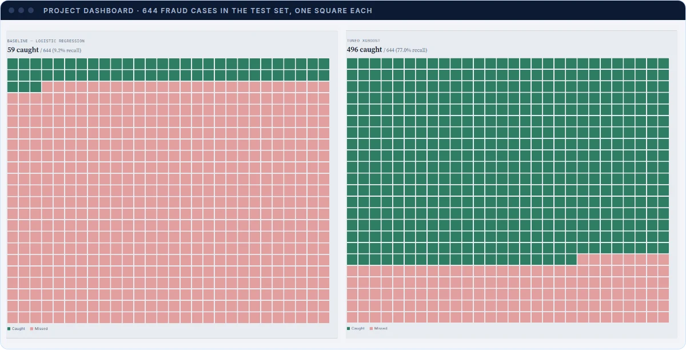
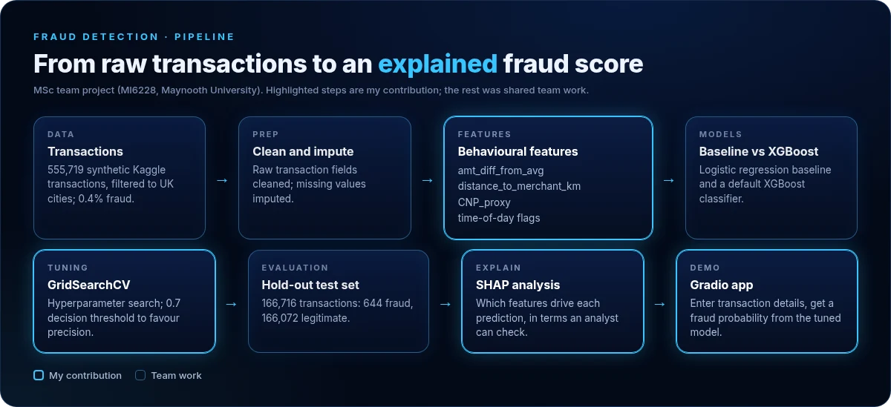
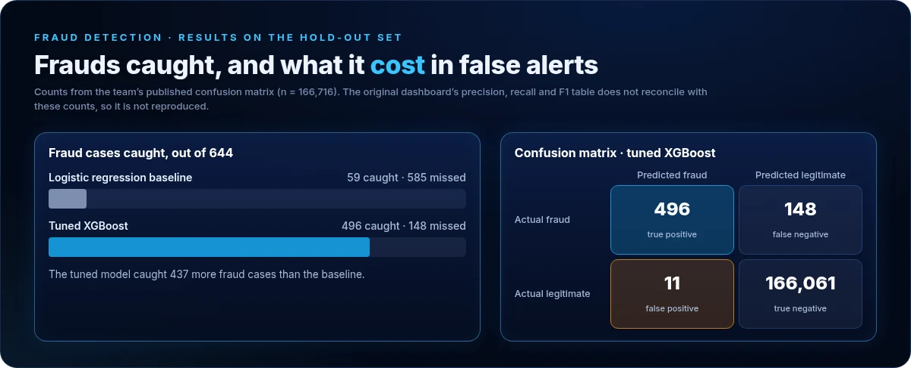
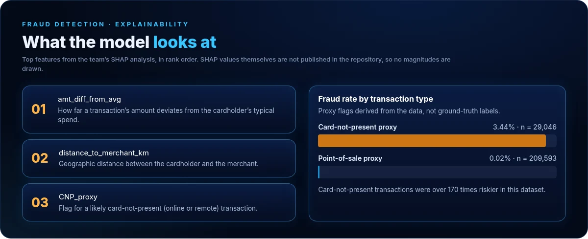

# Fraud Detection: an explainable XGBoost classifier

**Catching the fraud a baseline misses, and showing an analyst why each transaction was flagged.**

MSc Business Analytics team project (module MI6228, Maynooth University) · Python · XGBoost · SHAP · Gradio

[**Live dashboard**](https://fraud-detection-xgboost.netlify.app/) · [Portfolio](https://basant-kumar-portfoli.netlify.app/) · [GitHub profile](https://github.com/basant-kumarr)

  

---

## The problem

Card fraud is rare: 0.4% of transactions in this dataset. A model can look accurate while missing most fraud, and a model that flags too much buries investigators in false alerts. A fraud operations team needs a model that catches more fraud, keeps false alerts low, and can explain each decision.

## Objective

Build and evaluate a fraud-detection pipeline on a severely imbalanced dataset, compare it with an interpretable baseline, and explain which transaction behaviours separate fraud from legitimate activity.

## My contribution

Team project (Group 6B: Karishma Yadav, Aadhish, Abhinand, Basant Kumar, Sreejith, Varun). My part:

- **Feature engineering:** behavioural features such as spend deviation from the cardholder's average, distance to merchant and a card-not-present proxy.
- **XGBoost tuning:** GridSearchCV and a precision-first decision threshold of 0.7.
- **SHAP analysis:** explaining which features drive predictions.
- **Gradio deployment:** an interactive demo of the tuned model.

Data cleaning, the baseline model and evaluation were shared team work.

## How it works

  

1. **Data.** 555,719 transactions from a public synthetic Kaggle credit-card dataset, filtered to UK cities, with a 0.4% fraud rate. This is simulated data, not real card-network data.
2. **Preparation.** Raw fields cleaned and missing values imputed.
3. **Behavioural features.** `amt_diff_from_avg`, `distance_to_merchant_km`, `CNP_proxy` and time-of-day flags. These describe how a transaction differs from normal behaviour, which keeps the model readable for an analyst.
4. **Models.** A logistic regression baseline and a default XGBoost classifier. The baseline is a standard, interpretable benchmark that XGBoost has to clearly beat.
5. **Tuning.** GridSearchCV over XGBoost hyperparameters, with a 0.7 threshold so that alerts are precise.
6. **Evaluation.** A hold-out test set of 166,716 transactions (644 fraud, 166,072 legitimate).
7. **Explanation.** SHAP shows which features push a prediction towards fraud.

## Results

  

| On the hold-out set (n = 166,716) | Logistic regression baseline | Tuned XGBoost |
|---|---|---|
| Fraud cases caught, of 644 | 59 | **496** |
| Fraud cases missed | 585 | 148 |
| False alerts, of 166,072 legitimate transactions | not published | **11** |

The tuned model caught **437 more** fraud cases than the baseline. The team reported an AUC-ROC of **99.9%** for the tuned model.

> **Metric reconciliation.** An earlier version of this README and the dashboard show a precision, recall and F1 table (for example, 81.7% recall and 97.2% precision for the tuned model). Those percentages do not match the published confusion matrix: 496 of 644 is 77.0% recall, and 496 true positives with 11 false positives is 97.8% precision. Until the underlying evaluation is re-run and reconciled, only the confusion-matrix counts above are presented as results.

## Explainability

  

- The three most influential features in the team's SHAP analysis were `amt_diff_from_avg`, `distance_to_merchant_km` and `CNP_proxy`. SHAP values are not published in this repository, so the image shows rank order only.
- Card-not-present proxy transactions had a **3.44%** fraud rate (n = 29,046), against **0.02%** for point-of-sale proxy transactions (n = 209,593).

## Technology

| Technology | What it contributes |
|---|---|
| Python, pandas | Data cleaning, imputation and feature engineering |
| scikit-learn | Logistic regression baseline and model evaluation |
| XGBoost | Gradient-boosted classifier that copes well with severe class imbalance |
| GridSearchCV | Systematic hyperparameter search for the tuned model |
| SHAP | Per-feature explanation of model predictions |
| Gradio | Interactive demo: enter transaction details, get a fraud probability |
| HTML, CSS, JavaScript | The dashboard in this repository: hand-built SVG and CSS charts, no chart library |

## Limitations

- Card-not-present and point-of-sale labels are heuristic proxies, not ground truth.
- One static decision threshold; it does not adapt by merchant category or in real time.
- Trained and evaluated on static batch data, with no streaming.
- The dataset is synthetic and lacks demographics and device or browser metadata.
- The precision, recall and F1 percentages need to be reconciled with the confusion matrix (see above).

## What is in this repository

| File | Contents |
|---|---|
| `index.html` | The project dashboard, deployed at [fraud-detection-xgboost.netlify.app](https://fraud-detection-xgboost.netlify.app/) |
| `docs/images/` | The figures used in this README |

The training notebook and the Gradio app are not published in this repository.

## Possible next steps

- Score transactions in real time behind an API or streaming pipeline.
- Retrain from analyst-confirmed outcomes.
- Add unsupervised anomaly detection for unseen fraud patterns.
- Tune thresholds per merchant category.

---

**Basant Kumar** · MSc Business Analytics, Maynooth University · [Portfolio](https://basant-kumar-portfoli.netlify.app/) · [LinkedIn](https://www.linkedin.com/in/basantsingh-/) · [GitHub](https://github.com/basant-kumarr)
